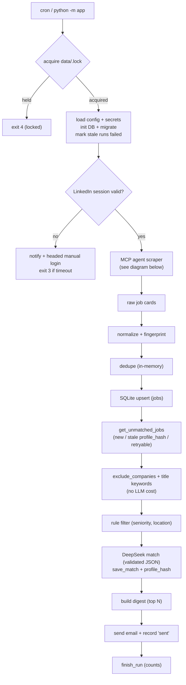

# LinkedIn Job Hunter Agent

A local, autonomous LinkedIn job monitoring system. It periodically searches LinkedIn
for roles matching your profile, deduplicates and filters results, uses DeepSeek to
semantically score each remaining job, and emails a single digest of the best new matches.

LinkedIn is the only job source. Authentication is always manual — the app never bypasses
LinkedIn login, CAPTCHA, MFA, or security checks.

## Architecture

One run, end to end:



### MCP scraper flow

```mermaid
flowchart TD
    start["McpScraper.collect()"] --> spawn["start npx @playwright/mcp over stdio<br/>--user-data-dir data/browser_profile"]
    spawn --> tools["list_tools() then allowlist<br/>navigate/snapshot/click/scroll/press/wait"]
    tools --> loop["for each query x location"]
    loop --> agent["deepagents agent + GuardMiddleware"]
    agent --> budget{"budget ok?<br/>llm / steps / tool / tokens / time"}
    budget -- "no" --> stop["stop query (safety limit)"]
    budget -- "yes" --> call["model picks next tool"]
    call --> urlguard{"navigate URL under<br/>linkedin.com/jobs/ ?"}
    urlguard -- "no" --> reject["reject + count"]
    urlguard -- "yes" --> exec["execute tool"]
    exec --> wall{"login wall / captcha?"}
    wall -- "yes" --> abort["LoginWallError + notification email"]
    wall -- "no" --> wrap["wrap snapshot as untrusted data<br/>+ truncate"]
    wrap --> extract["model extracts job cards as JSON"]
    extract --> parse["Pydantic validate -> job dicts"]
    parse --> done["return cards -> storage pipeline"]
    reject --> call
```

See `final_plan.md` for the full implementation contract.

## Requirements

- Linux (tested on Ubuntu 24.04)
- Python 3.11+
- Chromium for Playwright (installed by `playwright install chromium`)
- Node.js 18+ and `npx` (required for the `@playwright/mcp` scraper)
- A DeepSeek API key
- A Gmail account with an App Password (or any SMTP provider)
- A display is needed only for the interactive login step

## Installation

```bash
cd /home/raunaq/Desktop/linkedin_agent
python3 -m venv .venv
.venv/bin/pip install -e ".[dev]"
.venv/bin/playwright install chromium
```

## Environment variables

Copy `.env.example` to `.env` and fill it in:

```bash
cp .env.example .env
```

| Variable | Purpose |
|----------|---------|
| `DEEPSEEK_API_KEY` | DeepSeek API key |
| `DEEPSEEK_BASE_URL` | Defaults to `https://api.deepseek.com` |
| `DEEPSEEK_MODEL` | Defaults to `deepseek-chat` |
| `SMTP_HOST` / `SMTP_PORT` | SMTP server (Gmail: `smtp.gmail.com` / `587`) |
| `SMTP_USER` / `SMTP_PASSWORD` | SMTP login (Gmail App Password) |
| `EMAIL_FROM` / `EMAIL_TO` | Sender and recipient (comma-separate multiple) |

Non-secret behavior lives in `config/config.yaml`; the candidate profile lives in
`config/profile.yaml`. A fully commented template is provided in
`config/config.example.yaml` (`cp config/config.example.yaml config/config.yaml`).

## First-time LinkedIn login (manual)

Authentication is manual. Launch the helper once:

```bash
.venv/bin/python scripts/login.py
```

A browser window opens. Log in to LinkedIn (including MFA if prompted). The session is
stored in `data/browser_profile/`. The window closes automatically once the session is
valid. You should not need to log in again until LinkedIn expires the session.

## Persistent browser profile

Playwright uses a dedicated profile at `data/browser_profile/` — never your normal Chrome
profile. It is gitignored and retained between runs.

## Session expiration

Before each run the app checks the session:

1. If valid, it continues automatically (headless).
2. If expired/unknown, it sends a "login required" email, opens a headed browser, and waits
   up to `browser.manual_login_timeout_s` (default 15 minutes) for you to log in manually.
3. On success it continues; on timeout it logs, exits with code 3, and retries next cron run.

It never attempts to bypass security challenges.

## Scraper (`mcp`)

Scraping is done exclusively through
[`@playwright/mcp`](https://github.com/microsoft/playwright-mcp), driven over
stdio by the Python `mcp` SDK and a bounded `deepagents` agent. It requires
**Node.js 18+** and `npx`, and reuses the same persistent login profile
(`runtime.browser_profile_dir`), so log in once with `scripts/login.py` first.

Settings live under `mcp` in `config/config.yaml`:

```yaml
mcp:
  command: "npx"
  args: ["@playwright/mcp@latest"]
  headless: true
```

Safety guardrails (enforced in code, not just prompt):

- **Hard budgets** — `max_llm_calls_per_query`, `max_llm_calls_per_run`,
  `max_steps_per_query`, `max_tool_calls_per_query`, `max_total_tokens_per_run`,
  `max_wall_clock_s_per_query`. Exceeding any of these aborts the query/run cleanly.
- **Tool allowlist** — only tools advertised by `list_tools()` that match
  navigate/snapshot/click/scroll/press/wait are exposed; typing, JS evaluation,
  file upload, and tab tools are withheld. `deepagents`' built-in file/subagent
  tools are stripped via a harness profile.
- **Navigation guard** — every navigate must target
  `https://www.linkedin.com/jobs/`; rejected calls are logged and counted.
- **Untrusted content** — snapshots are wrapped in explicit untrusted-data
  delimiters and truncated before reaching the model.
- **Login wall / checkpoint / captcha** — the run stops immediately, raises, and
  sends a notification email. Captchas are never solved and credentials are never
  entered.

Authentication is always manual and LinkedIn security controls are never
bypassed.

**What it extracts.** The scraper reads job cards from the page's
accessibility snapshot: title, company, location, workplace, and posted time for
every card on up to `search.max_pages_per_query` pages (the search URL already
filters to `posted_within_days`). The accessibility snapshot does **not** expose
per-job URLs, so each job is fingerprinted from company + title + location and
its link falls back to the search URL. Descriptions are not fetched (that would
require clicking every card and snapshotting each detail pane, which is very
token-expensive); matching runs on the card fields. Token-efficiency is enforced
by the budgets above plus a guard that withdraws tools near the limit so the
model must emit its final JSON instead of exploring.

## DeepSeek configuration

The matcher sends only filtered candidate jobs and scores them from the card fields
(title, company, location, posted time). Scraped data is treated as untrusted; the model is
instructed to ignore any instructions inside it, and its JSON output is
validated (`match`, `score`, `reason`, `matching_skills`, `missing_skills`). Malformed or
failed responses are retried, then skipped without crashing the run. Tune with
`matcher.min_score`, `matcher.max_jobs_per_run`, and `matcher.max_retries`.

## Search preferences (`search`)

Everything about *what* to search for lives in the `search` section of
`config/config.yaml`. One LinkedIn search URL is built per **(query, location)**
combination — no LLM is involved in building URLs. Invalid or missing values
fail at startup with an error naming the offending field.

| Field | Type | Description |
|-------|------|-------------|
| `queries` | list[str] | Job titles/keywords. Required; at least one non-empty entry. |
| `locations` | list[str] | Locations to search. Use `""` for worldwide. Defaults to `[""]`. |
| `posted_within_days` | int | Only jobs posted within N days (`0` disables the filter). |
| `experience_levels` | list[str] | ORed LinkedIn levels: `internship`, `entry`, `associate`, `mid-senior`, `director`, `executive`. Empty = no filter. |
| `workplace` | list[str] | ORed values: `remote`, `hybrid`, `onsite`. Empty = no filter. |
| `max_pages_per_query` | int | Result pages per URL (~25 jobs/page); caps results per search. |
| `exclude_companies` | list[str] | Case-insensitive company substrings; dropped in Python before matching. |
| `exclude_title_keywords` | list[str] | Case-insensitive title substrings; dropped in Python before matching. |

`exclude_companies` and `exclude_title_keywords` are applied before the matching
step, so excluded jobs never cost an LLM call. Other rejection logic (seniority,
title patterns, allowed locations) lives under `filters`.

## Email configuration

One digest is sent per run with all new matching jobs (HTML + plain-text). Already-emailed
jobs are never emailed again. Configure the subject prefix and digest size under `email` in
`config/config.yaml`.

## Running manually

```bash
.venv/bin/python -m app
```

Exit codes: `0` success, `1` fatal, `2` partial (some LLM errors), `3` authentication
required, `4` another run holds the lock.

## Running through cron

Use the venv Python explicitly. Example crontab entry (twice daily):

```cron
0 9,18 * * * cd /home/raunaq/Desktop/linkedin_agent && /home/raunaq/Desktop/linkedin_agent/.venv/bin/python -m app >> /home/raunaq/Desktop/linkedin_agent/logs/cron.log 2>&1
```

A file lock (`data/.lock`) prevents overlapping executions. A headed login under cron
requires a display; if one is unavailable, run `scripts/login.py` manually when the
login-required email arrives.

## Database

SQLite at `data/jobs.db` with tables `jobs`, `matches`, `email_log`, and `runs`. It
distinguishes NEW / SEEN / EMAILED jobs and tracks first/last-seen times, match
results (score, reason, skills), failed-attempt counts, and email status. The
`jobs` table stores only what card-level scraping yields (`title`, `company`,
`location`, `url`, `posted_text`, timestamps, `match_attempts`). The schema is in
`app/db/schema.sql`; `init_db` applies additive/removal migrations to existing
databases on startup.

## Testing

```bash
.venv/bin/python -m pytest
```

Unit tests use fixtures and mocks and do not require live LinkedIn access. Live tests (if
added) are marked `live` and deselected by default.

## Troubleshooting

- **Login required email**: run `scripts/login.py`, then wait for the next run or run manually.
- **No jobs found**: LinkedIn may have changed its page layout, or a budget stopped the
  agent early. Check `logs/run.log` for the MCP tool calls/budget reason; adjust the
  prompt or budgets in `app/browser/mcp_scraper.py` / `config.yaml` if needed.
- **Exit code 4**: a previous run still holds the lock; check for a stuck process.
- **No email received**: verify `.env` SMTP settings and that App Passwords are enabled.
- **DeepSeek errors**: check `DEEPSEEK_API_KEY`, quota, and `logs/run.log`.
